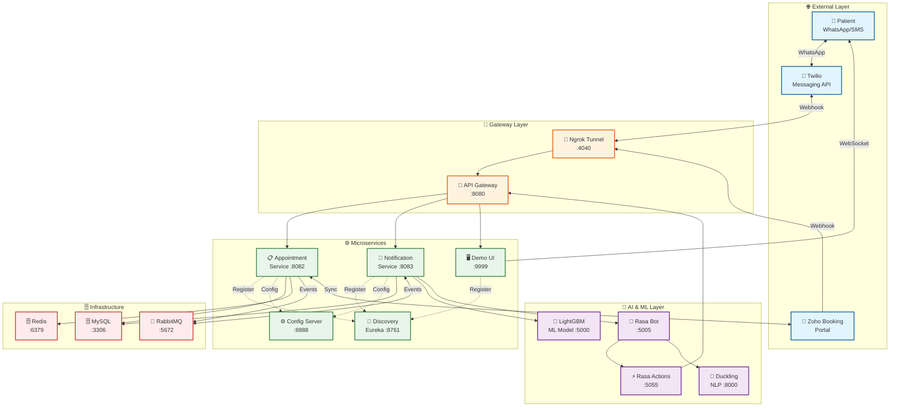
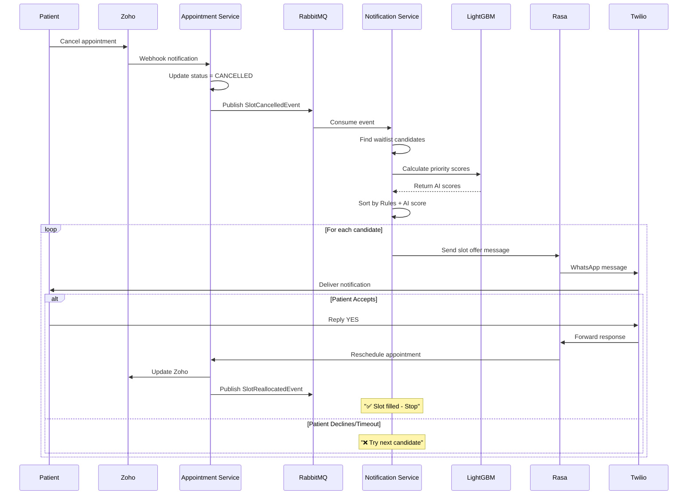

# SmartScheduler - Intelligent Appointment Optimization

[](https://www.oracle.com/java/)
[](https://spring.io/projects/spring-boot)
[](https://rasa.com/)
[](https://www.docker.com/)

## What is SmartScheduler?

An AI-powered system that automatically fills cancelled appointment slots by:
1. Detecting cancelled slots in real-time
2. Prioritizing eligible patients using Rules + Machine Learning
3. Sending WhatsApp/SMS notifications via conversational AI
4. Reallocating slots to first accepting patient
5. Syncing with Zoho Booking platform

**Result:** Maximize clinic revenue, minimize idle time, improve patient experience.

---

## Key Features

- **Automatic Slot Detection** - Monitors cancellations via Zoho webhooks
- **Hybrid Prioritization** - Rules-based + LightGBM AI scoring
- **Sequential Notification** - One-by-one notification with timeout management
- **Conversational AI** - Natural language via Rasa chatbot
- **Multi-Stage Fallback** - Waitlist → Same-day patients → Public booking
- **WhatsApp/SMS** - Patient communication via Twilio
- **Real-time Sync** - Bidirectional Zoho Booking integration
- **Event-Driven** - Asynchronous processing with RabbitMQ
- **Demo UI** - WebSocket visualization of notification flow

---

## Architecture

### System Architecture Diagram



### Key Flow: Cancelled Slot → Patient Notification



### Component Summary

| Layer | Components | Purpose |
|-------|------------|---------|
| **External** | Patient, Zoho, Twilio | User interaction & external services |
| **Gateway** | Ngrok, API Gateway | Public access & routing |
| **Discovery** | Eureka (8761) | Service registry |
| **Core Services** | Appointment (8082), Notification (8083), Demo (9999) | Business logic |
| **AI/ML** | Rasa (5005), LightGBM (5000), Duckling (8000) | Intelligence & NLP |
| **Infrastructure** | MySQL (3306), Redis (6379), RabbitMQ (5672) | Data & messaging |

---

## Technology Stack

| Category | Technologies |
|----------|-------------|
| **Backend** | Java 21, Spring Boot 3.5.5, Spring Cloud 2025.0.0 |
| **Database** | MySQL 8.0, Spring Data JPA |
| **Messaging** | RabbitMQ 3.11 (AMQP) |
| **Caching** | Redis 7.0 |
| **AI/ML** | Rasa 3.6.21, LightGBM, Duckling |
| **External APIs** | Zoho Booking, Twilio |
| **Containerization** | Docker, Docker Compose |
| **Build** | Maven |

---

## Quick Start

### Prerequisites
- Docker & Docker Compose
- Zoho Booking account (OAuth credentials)
- Ngrok account (auth token)
- Twilio account (optional, for production)

### 1. Clone & Configure
```bash
git clone https://github.com/mariasstalin/smart-scheduler.git
cd smart-scheduler
```

Edit `.env` file:
```env
# Zoho Credentials
ZOHO_CLIENT_ID=your_client_id
ZOHO_CLIENT_SECRET=your_client_secret
ZOHO_REFRESH_TOKEN=your_refresh_token

# Ngrok
NGROK_AUTHTOKEN=your_ngrok_token

# Notification Settings
NOTIFICATION_MESSAGING_PROVIDER=demo  # Use 'demo' for testing, 'twilio' for production
NOTIFICATION_PATIENT_PRIORITY_ENGINE=ai-based  # Options: 'rule-based' or 'ai-based'
NOTIFICATION_SCHEDULING_RESPONSE_WINDOW_MINUTES=1
NOTIFICATION_SCHEDULING_MAX_CONSECUTIVE_MISSES=3
```

### 2. Start Services
```bash
docker compose --profile prod up -d --build
```

Wait 3-5 minutes for all services to start. If any fail, run:
```bash
docker compose --profile prod up -d
```

### 3. Configure Ngrok Domain
Open http://localhost:4040, copy your public URL, and update `.env`:
```env
NGROK_DOMAIN=https://your-subdomain.ngrok-free.app
```

Restart:
```bash
docker compose restart ngrok
```

### 4. Configure Zoho Webhooks
Update Zoho Flow webhook URLs:
- `https://your-ngrok-domain/appointment/webhook/zoho/book`
- `https://your-ngrok-domain/appointment/webhook/zoho/cancel`
- `https://your-ngrok-domain/appointment/webhook/zoho/reschedule`

### 5. Test
1. Book appointment on Zoho Portal
2. Cancel the appointment
3. Open Demo UI: http://localhost:9999
4. Watch automatic notification flow

---

## Services & Ports

| Service | Port | URL | Purpose |
|---------|------|-----|---------|
| API Gateway | 8080 | http://localhost:8080 | Main entry point |
| Eureka | 8761 | http://localhost:8761 | Service registry |
| Appointment | 8082 | http://localhost:8082 | Appointment management |
| Notification | 8083 | http://localhost:8083 | Notification engine |
| Demo UI | 9999 | http://localhost:9999 | WebSocket chat UI |
| Rasa | 5005 | http://localhost:5005 | Conversational AI |
| LightGBM | 5000 | http://localhost:5000 | ML scoring |
| MySQL | 3306 | localhost:3306 | Database (root/root) |
| RabbitMQ UI | 15672 | http://localhost:15672 | Queue management (root/root) |
| Ngrok | 4040 | http://localhost:4040 | Tunnel inspector |

---

## How It Works

### Priority Calculation

**Rules-Based Factors:**
- VIP status
- Patient responsiveness rate
- Consecutive missed notifications
- Opt-out period

**AI-Based (LightGBM):**
- Predicts acceptance probability (0.0-1.0)
- Input features: VIP status, severity, responsiveness, booking history

**Final Score = Rules Weight + AI Weight**

### Notification Flow

**Stage 1: Waitlist Patients**
- Notify waitlist patients matching doctor + date
- Sequential processing with timeout

**Stage 2: Same-Day Patients**
- Offer earlier slot to patients with later appointments

**Stage 3: Public Booking**
- Open slot in Zoho for new bookings

---

## Configuration

Key settings in `.env`:

```env
# Priority Engine: "rule-based" or "ai-based"
NOTIFICATION_PATIENT_PRIORITY_ENGINE=ai-based

# Messaging: "demo" or "twilio"
NOTIFICATION_MESSAGING_PROVIDER=demo

# Response timeout (minutes)
NOTIFICATION_SCHEDULING_RESPONSE_WINDOW_MINUTES=1

# Max misses before opt-out
NOTIFICATION_SCHEDULING_MAX_CONSECUTIVE_MISSES=3

# Opt-out duration (ISO-8601)
NOTIFICATION_SCHEDULING_OPT_OUT_DURATION=PT15M
```

---

## API Examples

### Book Appointment (Zoho Webhook)
```http
POST /appointment/webhook/zoho/book
{
  "zohoId": "123456",
  "doctorId": 1,
  "patientPhone": "919999999911",
  "startTime": "2025-01-15T10:00:00Z"
}
```

### Predict Priority Score (LightGBM)
```http
POST /predict
{
  "cancelled_slot": "2025-01-15 10:00",
  "user_details": {
    "isVip": true,
    "severityLevel": 3,
    "totalNotificationsResponded": 8,
    "totalNotificationsSent": 10,
    "bookingHistory": ["2024-12-01T10:00:00"]
  }
}

Response: { "score": 0.847 }
```

---

## Troubleshooting

```bash
# View logs
docker compose logs -f notification

# Check service health
docker ps
curl http://localhost:8082/actuator/health

# Restart service
docker compose restart appointment

# Connect to database
docker exec -it mysql mysql -uroot -proot smart_scheduler
```

---

## Database Schema

**Key Tables:**
- `patients` - Patient profiles with VIP status and responsiveness metrics
- `doctors` - Doctor profiles
- `appointments` - Appointments with status (UPCOMING, CANCELLED, etc.)
- `waitlist` - Waitlist entries with preferred dates
- `notifications` - Notification history with responses

---

## Deployment

**Local Development:**
```bash
# Start infrastructure only
docker compose --profile local up -d mysql redis rabbitmq rasa light-gbm
```

**Production:**
See [DEPLOYMENT.md](DEPLOYMENT.md) for detailed guide.

---

## Project Structure

```
smart-scheduler/
├── appointment/          # Appointment service (8082)
├── notification/         # Notification service (8083)
├── demo/                 # Demo UI (9999)
├── discovery/            # Eureka server (8761)
├── gateway/              # API Gateway (8080)
├── config/               # Config server (8888)
├── common/               # Shared entities & repositories
├── rasa/                 # Rasa chatbot
├── rasa-actions/         # Rasa custom actions
├── light-gbm/            # ML priority service
├── duckling/             # Date/time extraction
├── db/                   # Database init scripts
├── docker-compose.yml    # Service orchestration
└── .env                  # Configuration
```

---

## Contributing

1. Fork the repository
2. Create feature branch: `git checkout -b feature/name`
3. Commit changes: `git commit -m "Add feature"`
4. Push: `git push origin feature/name`
5. Open Pull Request

---

## License

MIT License - see [LICENSE](LICENSE) file.

---

## Author

**Stalin Jeyaraj**
GitHub: [@mariasstalin](https://github.com/mariasstalin)
Year: 2025

---

## Support

- **Deployment Guide**: [DEPLOYMENT.md](DEPLOYMENT.md)
- **Issues**: [GitHub Issues](https://github.com/mariasstalin/smart-scheduler/issues)
